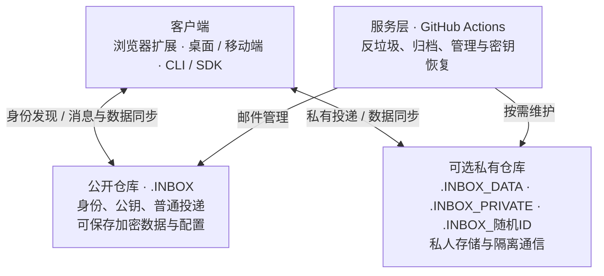

<div align="center">

# GitHub-Mutual-visit-Inbox

**基于 GitHub 的异步端到端加密通信协议**

</div>

<br/>

## 1. 概述

GitHub 为开发者提供了身份体系、仓库存储、Discussions 和自动化工作流，却缺少用户之间通用的私信机制。公开讨论适合项目协作，却不适合直接交换私人内容；传统加密邮件则涉及邮箱服务、密钥发现和客户端之间的协作。我们希望在 GitHub 现有基础设施上解决这两个问题。

**我们设计了一种以 GitHub 仓库为邮箱、以 Discussions 和私密漏洞报告为投递渠道、以客户端密码学保护邮件内容的异步通信协议。** 它借助 GitHub 账号发现通信对象，通过仓库保存邮件与状态，使用 GitHub Actions 执行异步维护任务，并允许用户自由选择浏览器扩展、独立客户端或其他实现。

系统由四部分组成：



最简部署只需要一个仓库。用户可以直接在 `.INBOX` 中保存经过加密的邮件、联系人、设置和密钥备份，并使用该仓库的 Secrets 与 Actions。

需要私有存储或隔离通信时，可以增加扩展仓库：

```text
<user>/.INBOX                Public   身份发现、公开投递、加密数据与配置
<user>/.INBOX_DATA           Private  可选的私有存储、设置与归档
<user>/.INBOX_PRIVATE        Private  可选的共享私密邮箱
<user>/.INBOX_<random-id>    Private  可选的单联系人隔离信箱
```

用户自行选择数据位置和仓库数量。客户端将各处的消息与状态汇总成统一邮箱；端到端加密保护内容，身份签名验证来源，私有仓库进一步收窄访问范围。

## 2. 传输（Transport）

协议将消息内容与投递渠道分离。同一份经过加密和签名的消息，可以经由不同 GitHub 资源送达；接收端负责统一解析、去重和验证。

### 2.1 Discussions

GitHub Discussions 是默认投递渠道，可运行在公开 `.INBOX` 和授权访问的私有仓库中。GitHub 的 [Discussions GraphQL API](https://docs.github.com/en/graphql/guides/using-the-graphql-api-for-discussions) 已提供新建讨论和添加评论等操作。

协议为普通邮件和控制消息制定了不同的回复规则：

**每封普通邮件都创建一个新的 Discussion；回复旧邮件时同样新建 Discussion。原帖评论保留给协议控制消息。**

新邮件通过加密信封中的 `conversationId` 和 `inReplyTo` 等信息关联到原会话。客户端按照这些关联整理为邮件线程，GitHub 页面则仍保留独立帖子的结构。这使邮件可以分别投递、归档、过滤和清理，不依赖某个长时间存活的讨论串。

公开 Discussions 会暴露作者、时间及互动等元数据；私有仓库通过访问控制缩小这些数据的可见范围。两种渠道均使用端到端加密保护正文。

### 2.2 私密漏洞报告

另一个可选渠道是 **Private Vulnerability Reporting（PVR）**：向开启该功能的公开仓库提交私密漏洞报告，通过关联的 Repository Security Advisory 继续交流。它具有 GitHub 层面的访问控制，消息仍使用本协议的端到端加密。

GitHub 于 2026 年 10 月开放了[安全公告评论 REST API 的公开预览](https://github.blog/changelog/2026-10-02-repository-security-advisory-comments-api-in-public-preview/)，支持读取、添加和编辑符合权限要求的评论。协议可为该渠道定义与 Discussions 相同的邮件信封和控制消息语义。

PVR 目前面向真实安全漏洞披露。它的 API 权限、表单流程和平台使用政策仍需进一步验证，因此协议将其列为**可选的实验性渠道**；私有 Discussions 则承担通用私密通信的主要用途。

### 2.3 特殊投递与协议回复

普通邮件总是创建新的投递实体：Discussions 渠道创建新 Discussion；若 PVR 渠道经验证可用，则创建新的报告。**只有协议控制消息才允许直接回复原投递实体**：在 Discussion 下添加 Comment，或通过 PVR 支持的评论接口写入。

这类特殊回复可用于好友申请的确认、接受私有信箱邀请的意愿、密钥验证挑战、投递确认及其他明确需要与原请求绑定的操作。

例如，Alice 将邮箱切换为私有模式后，可先向 Bob 发送一封加密的迁移通知。Bob 的客户端显示“继续联系”；Bob 确认后，客户端在**该通知原帖**发表控制回复。Alice 的客户端检测到回复，再向 Bob 发送 GitHub 仓库协作邀请。Bob 接受 GitHub 邀请后，双方才切换到新投递位置。这样可避免直接向全部联系人发送无差别的仓库邀请。

消息信封至少需要唯一消息 ID、协议版本、消息类型、发送与接收身份、会话关联、使用的密钥版本及签名。具体字段、编码方式和哪些元数据需要加密，留待协议规范确定。客户端以 GitHub API 返回的作者身份和密码学签名交叉验证消息来源。

## 3. 身份（Identity）

协议以 GitHub 账号作为身份发现入口，以 GitHub **不可变用户 ID** 绑定身份记录。客户端根据当前用户名解析约定仓库，并记录仓库 ID，用于识别仓库重建或转移。

公开身份文件公布身份签名公钥、邮件加密公钥、密钥版本和投递能力。计划将两种用途分离：使用 Ed25519 类签名密钥证明消息与身份更新的来源，使用 X25519 类加密密钥保护消息内容。具体密码套件将在正式协议中规范化。

首次联系可以采用 **TOFU（Trust On First Use，首次使用即信任）**：客户端保存对方的可信身份公钥指纹。此后发现公钥变化时，客户端显示类似 SSH 主机指纹更换的警告，并核验密钥轮换证明。

身份更新遵循以下规则：

- **改名**：以 GitHub 用户 ID 识别同一账号，重新解析仓库；可使用旧身份密钥签署更名声明，但继续沿用原有身份信任关系。
- **更换加密密钥**：由已信任的身份密钥签署新的加密公钥，允许客户端验证后更新。
- **更换身份密钥**：优先提供旧身份私钥签署的轮换证明；缺少有效证明时警告并暂停向新密钥发送敏感内容。
- **自身身份检查**：客户端从自己已解锁的私钥导出公钥，并与 GitHub 当前公布的公钥比较。发生不一致时，提示可能的仓库篡改或其他设备的未同步操作。

首次验证可以通过其他可信渠道核对指纹，提高对首次公钥替换攻击的抵抗力。客户端本地保存可信指纹和已接受的最高密钥版本，防止服务器端记录被篡改或回滚。

## 4. 验证与反垃圾

好友关系由协议中的信任记录定义，与 GitHub 的 Follow 关系相互独立。邮箱所有者可以公开允许陌生人投递，也可以要求先通过好友验证。

发起申请时，发送方查询收件人的公开策略和公钥，提交加密、签名的好友请求；接收方同意后，在自己的联系人存储中保存对方的 GitHub 用户 ID、公钥及信任状态，并发送签名确认。好友名单可以整体加密保存在 `.INBOX` 或 `.INBOX_DATA`，避免直接暴露社交关系。

好友验证控制客户端的接收与展示；GitHub 原生仓库权限则负责服务器端写入控制。公开 Discussions 仍允许符合 GitHub 权限要求的用户发表内容，因此协议同时提供用户自定义反垃圾策略：按发送者、好友状态、发送频率、重复行为、签名有效性或总流量进行过滤、限速、隔离或封禁。客户端可以探测收件方公布的接收策略，在发送前提示好友验证要求；具体风控阈值可以保存在加密配置或受保护的 Actions 配置中。需要由 Action 自动执行的规则，应向工作流提供最小必要的可读取参数。拉黑状态由收件方决定是否公开。

GitHub Actions 可以通过 Discussions 事件执行自动检测，而不必每小时等待一次定时扫描。事件处理属于**写入后的处置**：GitHub 已接收的消息由 Action 增量扫描，再按策略隔离、删除或限制发送者。因此，反垃圾任务应批量处理增量消息、具备幂等性，并设置必要的全局流量保护。跨仓库事件通过显式调度或客户端同步衔接，定时扫描负责核对并补偿遗漏事件。

严重攻击时可启用 GitHub 原生仓库交互限制，必要时由获得明确用户授权的服务调用 GitHub 账号拉黑 API。协议分别提供邮箱级拉黑和 GitHub 账号级拉黑，后者需要用户单独授权，因为它会影响账号其他互动。[Repository Interaction Limits](https://docs.github.com/en/rest/interactions/repos) 按 GitHub 定义的用户类别限制仓库互动，适合作为突发垃圾消息时的应急措施。

对于需要写入前隔离的用户，可以转用私有仓库：

- `.INBOX_PRIVATE`：多个已授权联系人共享的私有信箱。
- `.INBOX_<随机ID>`：每个联系人一个独立的私有信箱。不同联系人之间不能直接读取彼此的通信仓库。

私有模式的邀请采取“先发加密通知、待对方通过原帖特殊回复确认、再发送 GitHub 邀请”的握手方式。好友关系、仓库访问授权和实际密钥信任始终分别管理。

## 5. 安全（Security）

安全设计分为三个目标：消息内容的**机密性**、身份与数据的**完整性**，以及删除、限流和故障情况下的**可用性**。GitHub 仓库、第三方应用和 Actions Runner 被纳入威胁模型，敏感操作由客户端密码学机制保护。

### 5.1 内容加密与数据位置

每封消息使用独立的随机内容密钥加密，内容密钥再分别封装给接收者及需要保存发件副本的发送者。正文、草稿、联系人、设置和归档索引等数据均可由客户端加密后存入公开 `.INBOX`。希望减少 GitHub 仓库访问者对数据及元数据的接触时，可以使用私有 `.INBOX_DATA`。两种部署方式采用相同的加密与签名协议。

公开 Discussions 让历史密文容易被第三方收集。若长期使用同一解密私钥封装消息密钥，该私钥未来泄露可能导致大量历史邮件被解密。密钥轮换可以缩小泄露影响范围；完整的前向保密还需要专用会话密钥协议。未来可为安全会话设计预密钥与 Double Ratchet；同时必须解决旧邮件长期归档、多设备恢复和删除旧会话密钥之间的矛盾。

### 5.2 私钥备份与密码保护

私钥可以仅保存在可信客户端，也可以备份到 `.INBOX` 或 `.INBOX_DATA` 的加密文件，或者由相应仓库的 GitHub Actions **Secrets** 托管。选择 Secrets 时，同样可以在上传前使用用户密码再加密一层：

```text
用户密码 → Argon2id 等 KDF → 密钥加密密钥
                                      ↓
                              加密随机主密钥
                                      ↓
                           加密身份私钥／邮件私钥
                                      ↓
                     加密备份 → 文件或 Actions Secret
```

这样第三方应用即使读到备份，或诱导 Action 输出备份，也不应在不知道用户密码的情况下得到明文私钥。密码强度仍然重要：获得密文者可以离线猜测弱密码。GitHub Actions Variables 只能用于公开配置或**已独立加密**的备份，不能替代 Secrets。

若私钥以 Secret 保存，客户端可生成一次性接收密钥，通过有权限的 `workflow_dispatch` 请求恢复；Action 只将**仍受用户密码保护**的备份再封装给一次性公钥。恢复请求需要独立的授权验证，具有 Secrets 权限的工作流只接收经过验证的管理输入，与公共 Discussion 事件隔离。普通投递、反垃圾与密钥恢复应使用隔离的工作流及最小权限。

### 5.3 恶意 GitHub Apps 与身份替换

GitHub App 的安装范围以及 OAuth App 的授权范围，决定了第三方应用可能接触哪些仓库。因而协议以客户端加密保护明文和私钥，并以仓库权限减少暴露面积。客户端加密防止仅具有读取权限的应用直接获得内容；数字签名、可信公钥指纹和密钥轮换证明用于发现公钥替换、伪造消息及重要配置篡改。

当联系人身份密钥无有效证明地改变时，客户端显示 SSH 风格的高风险告警并暂停使用新密钥发信。检测到**自己的**公开公钥与本地私钥不匹配，也必须给出单独告警。首次接触时，可通过其他可信渠道核对密钥指纹；之后的公钥变化告警则保护已经建立的身份信任关系。

删除、旧配置重放和历史回滚由本地可信版本状态与独立备份共同防护，客户端对异常回退发出告警。

### 5.4 私有仓库的权限边界

个人账号的私有仓库向 Collaborator 提供 Git 写权限。保存重要配置和密钥备份的仓库应由所有者独占写入权限：单仓库部署时由 `.INBOX` 承担，多仓库部署时可交给 `.INBOX_DATA`。邀请好友参与的私有投递仓库只承担通信，不放置私钥、Secrets 或受信任的管理工作流，并禁用 Actions；在平台与套餐支持时，可以使用 Rulesets 限制 Git 引用修改。Rulesets 保护 Git 引用，其他操作仍受仓库角色权限约束。组织仓库的细粒度只读角色可作为可选高级方案。[GitHub 权限说明](https://docs.github.com/en/repositories/managing-your-repositorys-settings-and-features/repository-access-and-collaboration/permission-levels-for-a-personal-account-repository)。

隔离式私有信箱将通信元数据限制在各自的授权范围内。GitHub 平台与获授权的应用仍可处理相应数据；撤销访问权限影响之后的访问，历史上已下载的副本由接收方持有。

### 5.5 删除、备份与可恢复性

Git 历史和 Repository Activity 可用于调查篡改、Push 与 Force Push；独立本地备份负责恢复。仓库可能被删除，旧 Git 对象也可能在重整历史后无法找回。客户端应提供独立的本地加密备份与恢复工具。

同样，清理公开 Discussion 可以降低在线暴露和仓库负担；第三方已经保存的历史密文则无法由邮箱所有者收回。因此，保密性主要由加密密钥管理保证，清理侧重存储维护。

## 6. 扩展（Extensions）

邮件数据可以保存在 `.INBOX`，也可以存入独立的 `.INBOX_DATA`。在统一的存储模型上，客户端可以提供传统邮件式的收件箱、**Sent、Drafts、Archive、Junk、Trash** 和自定义标签。各邮箱通过标签和状态组织，底层共享 Git 数据存储。

### 6.1 同步、归档和历史重整

客户端在线时可以增量同步；Actions 可定时或按需将公开 Discussions 中的合法密文归档为 `.INBOX` 内的加密文件，或保存到独立的 `.INBOX_DATA`。归档后先验证写入，再考虑清理公开 Discussion。同步与清理采用两个阶段：归档确认后，再清理已停止接收新内容的投递对象，处理新评论与删除之间的竞争。

承载归档的仓库可以批量提交、保存快照，并按需重整 Git 历史。历史重整用于控制 Git 仓库规模；安全删除另行考虑已克隆和已缓存的历史副本。GitHub 对仓库体积、Push 频率等仍有[建议限制](https://docs.github.com/en/repositories/creating-and-managing-repositories/repository-limits)，因此不宜为每次已读状态变化生成一次独立提交。

遇到严重垃圾消息或仓库配置损坏时，可以重建公开 `.INBOX`。重建流程负责校验仓库 ID、身份文件、授权、Discussion 分类和未归档邮件；日常归档则优先清理已完成的投递对象。

### 6.2 传统邮件兼容

协议核心可以对外提供本地适配服务：

- **GHIMAP**：将 `.INBOX` 或 `.INBOX_DATA` 中的邮件、文件夹、标志和搜索结果映射为 IMAP 邮箱，供 Thunderbird 等客户端读取和同步。
- **GHPOP**：提供较简单的 POP3 邮件获取接口。
- **GHSMTP**：作为本地邮件提交网关，解析 GitHub 收件人、加密内容，并通过 GitHub 传输层投递。

这三个组件是运行在本地或用户自托管环境中的**协议网关**。它们通过 GitHub API 提供传统邮件客户端接口；若需要与互联网普通邮箱互投，则需要进一步增加 SMTP 联邦网关及相应的信任和投递规则。传统客户端取得解密后的邮件时，也会进入需要保护的本地明文数据边界。

### 6.3 可替换的客户端

协议定义身份、消息传输、加密和存储方式，客户端可以由不同实现自由替换。用户可以根据使用习惯选择客户端，也可以在多个设备上使用不同客户端访问同一邮箱。

例如，可以开发浏览器扩展，在 `github.com/notifications` 添加加密邮件收件箱；可以开发独立的桌面和移动客户端，提供离线阅读、搜索和本地加密备份；也可以提供 CLI 与 SDK，供其他工具和自动化程序使用。

## 7. 总结

我们提出了一种基于 GitHub 仓库的异步加密通信系统。GitHub 已经提供身份、仓库和讨论功能，却缺少将它们组织成私人邮箱的机制。为此，我们使用公开仓库提供身份发现、邮件入口及加密数据存储，按需使用私有仓库保存数据和隔离通信，以 Discussions 等渠道传递密文，并借助 GitHub Actions 执行反垃圾、归档和维护任务。消息的加密与签名由客户端完成，公钥指纹和轮换证明用于维持身份信任。

系统只需要少量协调。发送与接收可以在不同时间完成，用户离线后仍可重新同步邮件；各用户独立管理自己的邮箱、密钥和投递规则，客户端也可以自由替换。传输渠道、数据存储和用户界面彼此分离，使不同保密等级、其他投递渠道及传统邮件接口能够在同一协议上共存。
